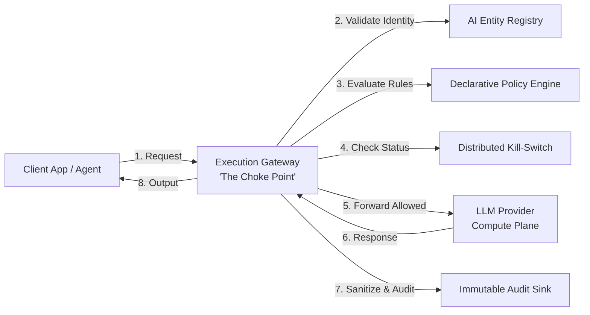

# AI Control Plane: Architectural Specification & Enterprise Blueprint

**Author:** Larry Arnold  
**Affiliation:** Founder, LA Builds & Systems Architect  
**Date:** January 2026 (Revised: October 2026)  
**Target Venue:** Enterprise Systems Whitepaper, IEEE Cloud / Software Architecture, Open Specification  

---

## Executive Summary

As enterprises transition from single-prompt experiments to autonomous multi-agent systems, organizations face an urgent architectural challenge: AI systems operate with opaque execution paths, unvetted tool access, and zero runtime policy enforcement. 

The **AI Control Plane** is an infrastructure-layer control architecture that strictly decouples the AI **compute plane** (model inference, fine-tuning, hosted LLM APIs) from the AI **control plane** (identity, declarative guardrails, telemetry, and kill-switch mediation). Built upon a choke-point execution gateway, machine-enforced declarative policies, immutable audit logging, and hardware-level kill-switch isolation, this specification provides deterministic oversight without degrading developer velocity.

---

## 1. Architectural First Principles



1. **Decoupled Control vs. Compute:** The Control Plane does not perform inference; it regulates, audits, and mediates access to compute.
2. **Identity Precedes Execution:** If an AI model, agent, or workflow is not explicitly cataloged in the Registry, all downstream API calls are rejected.
3. **Declarative Machine-Enforced Policy:** Rules beat heuristics. Policies are version-controlled, human-auditable YAML/JSON artifacts evaluated dynamically prior to inference.
4. **Unified Gateway Choke-Point:** All ingress prompts, tool invocations, and egress responses pass through an intercepting gateway. Bypassing the gateway results in network-level disconnection.
5. **Deterministic Fail-Safe and Kill-Switch:** System administrators possess instantaneous, cryptographically verified kill-switch authority at the individual agent, team, and global organizational tier.

---

## 2. Core System Pillars

### 2.1 AI Asset Registry
Centralized source of truth for all autonomous and semi-autonomous AI artifacts:
- **AI Entity ID:** Unique cryptographic identifier (UUIDv4).
- **Classification:** Static Model Wrapper, Autonomous Tool-Calling Agent, Multi-Agent Swarm, or Scheduled Daemon.
- **Upstream Endpoint:** Exact model and version (`claude-3-5-sonnet`, `gpt-4o`).
- **Risk Tiering:**
  - *Tier 1:* Read-Only public knowledge base.
  - *Tier 2:* Internal enterprise document access.
  - *Tier 3:* Write permissions (database updates, drafting emails).
  - *Tier 4:* Autonomous external actions (financial execution, API writes).
- **Ownership:** Engineering owner, team responsibility, hard token budgets.

### 2.2 Declarative Policy & Guardrail Engine
Machine-enforced rules defined via version-controlled YAML:

```yaml
policy_version: "2026.1"
agent_id: "agent_support_triage_042"
risk_tier: 3
allowed_tools:
  - "read_knowledge_base"
  - "draft_ticket_reply"
forbidden_tools:
  - "execute_refund"
  - "modify_database_record"
data_boundaries:
  pii_redaction: true
  allowed_tenants: ["tenant_us_east"]
rate_limits:
  max_tokens_per_hour: 250000
  max_cost_per_day_usd: 50.00
on_violation:
  action: "BLOCK_AND_ESCALATE"
  notify: "secops-alert@enterprise.internal"
```

### 2.3 The Choke-Point Execution Gateway
The single, authoritative network boundary:
- Ingress authentication and identity resolution.
- Dynamic policy evaluation against request payload and requested tool capabilities.
- Low-latency proxy forwarding to upstream model providers.
- Output post-processing (content safety, secret scanning, hallucination sanity checks).
- Asynchronous telemetry event dispatch to the audit layer.

### 2.4 Immutable Observability and Audit Layer
Black-box recorder for all enterprise AI interactions:
- Full timeline replay of tool invocations and model responses.
- Diffing outputs across prompt versions and model upgrades.
- Behavioral drift detection and anomalous token spikes.
- Cryptographically verifiable append-only storage for compliance audits.

### 2.5 Hierarchical Kill-Switch Architecture
- **Per-Agent Circuit Breaker:** Instantly pause an agent displaying unstable or unaligned behavior.
- **Capability Isolation:** Revoke specific tool access (e.g. disable write operations while preserving read capabilities).
- **Global Air-Gap:** Sever upstream model connections in the event of major enterprise security incidents.

---

## 3. Threat Model and Risk Mitigations

| Threat Vector | Risk Level | Control Plane Mitigation Mechanism |
| :--- | :---: | :--- |
| **Indirect Prompt Injection** | Critical | Gateway content pre-filtering & tool argument schema validation |
| **Data Exfiltration via Tools** | High | Declarative egress policy & strict network destination whitelisting |
| **Autonomous Financial Runaway** | High | Hard token budget quotas & mandatory human approval thresholds |
| **Unvetted Shadow Agents** | Medium | Zero-trust registry enforcement (unregistered calls rejected) |
| **Post-Incident Tampering** | High | Write-once append-only cryptographic audit logging |

---

## 4. Developer Experience & Python SDK Reference

Integrating an enterprise agent requires fewer than five lines of code:

```python
from ai_control_plane import GovernedClient

# Drop-in replacement for OpenAI / Anthropic client
client = GovernedClient(
    agent_id="agent_support_triage_042",
    control_plane_url="https://controlplane.enterprise.internal"
)

# Call mediated through policy engine and gateway
response = client.chat.completions.create(
    messages=[{"role": "user", "content": "Summarize user complaint"}],
    tools=["read_knowledge_base"]
)
```

---

## 5. Regulatory Alignment

- **NIST AI RMF 1.0:** Satisfies Govern (1.1, 1.2), Map (1.5), Measure (2.6), and Manage (2.3) functions.
- **EU AI Act (Regulation 2024/1689):** Meets Article 12 (Logging & Record-Keeping) and Article 14 (Human Oversight) requirements.
- **SOC2 Type II:** Provides verifiable identity and access control telemetry.

---

## References

1. National Institute of Standards and Technology, *Artificial Intelligence Risk Management Framework (AI RMF 1.0)*, NIST (2023).
2. OWASP Foundation, *OWASP Top 10 for Large Language Model Applications*, OWASP (2023).
3. European Union, *Artificial Intelligence Act: Regulation (EU) 2024/1689*, Official Journal of the European Union (2024).
4. E. A. Brewer, "Kubernetes and the Path to Cloud Native," *Communications of the ACM*, 58(7):65–72 (2015).
5. A. Shostack, *Threat Modeling: Designing for Security*, John Wiley & Sons (2014).
