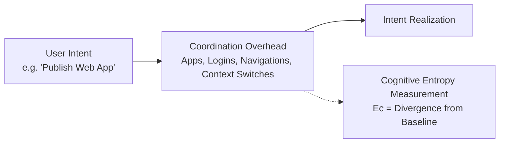

# Cognitive Entropy: Measurement Framework Version 0.1 (MF-0.1)

**A Formal Engineering Construct for Coordination Overhead in Digital Workflows**

**Author:** Larry Arnold  
**Affiliation:** LA Builds & Independent Researcher  
**Date:** July 12, 2026 (Revised: October 2026)  
**Target Venue:** ACM SIGCHI / IEEE Transactions on Human-Machine Systems, arXiv (`cs.HC` / `cs.CY`)  
**Status:** Provisional Research Standard & Working Specification  

---

## Abstract

Digital workflows increasingly require humans to coordinate across a proliferating landscape of applications, authentication challenges, context shifts, and interface-imposed micro-decisions to accomplish tasks that are conceptually elementary. While informally recognized as "friction" or "context switching," this coordination burden has lacked a formal, reproducible, and falsifiable measurement framework.

This specification defines **Cognitive Entropy** ($E_c$) not as a physical thermodynamic or Shannon information quantity, but as an empirical engineering construct: the normalized divergence between an observed human-system coordination process and an established empirical reference baseline required to fulfill identical user intent. Version 0.1 of this framework establishes an intent-task ontology; defines a three-tiered baseline hierarchy (Theoretical $B_t$, Empirical Reference $B_{\text{ref}}$, and Personal $B_u$) governed by the *Baseline Independence Principle*; details eight candidate variables spanning structural, interaction, cognitive, and noise dimensions; and specifies mathematical falsification protocols under Construct Validity.

---

## 1. System Ontology & Motivation

Modern digital knowledge work is characterized by acute coordination inflation. A simple intent requires traversing multiple authentication gates, tab switches, configuration dialogues, and disconnected software systems. Existing tools (GOMS/KLM, NASA-TLX) fail to separate **intrinsic task difficulty** from **systemic coordination friction**.

---

## 2. Design Principles

1. **Observability:** All variables must be strictly observable via passive telemetry and event logging without intrusive biometric hardware.
2. **Baseline Independence:** Normalization ensures $E_c$ scores reflect tool overhead rather than user intelligence or typing speed.
3. **Construct Validity:** $E_c$ must isolate coordination friction from intrinsic task difficulty.
4. **Bounded Normalization:** $E_c = 0$ represents optimal zero-coordination execution; $E_c = 1.0$ represents standardized baseline.
5. **Diagnostic Interpretability:** Decomposes into orthogonal components (structural, interactional, cognitive, and noise).

---

## 3. The Three-Tier Baseline Framework

- **Theoretical Baseline ($B_t$):** The theoretical zero-friction coordination lower bound.
- **Reference Baseline ($B_{\text{ref}}$):** Median performance of verified domain experts under controlled reference tooling:
  $$B_{\text{ref}} = \text{Median}\left(X_{\text{expert}}^{(1)}, X_{\text{expert}}^{(2)}, \dots, X_{\text{expert}}^{(k)}\right)$$
- **Personal Baseline ($B_u$):** Individual historical average used for longitudinal tracking.

---

## 4. The Eight Candidate Variables

| Dimension | Variable | Description |
| :--- | :--- | :--- |
| **Structural** | $N_{\text{apps}}$ | Total count of distinct application/domain context switches |
| **Structural** | $N_{\text{auth}}$ | Number of security checkpoints, 2FA prompts, and token gates |
| **Interaction** | $N_{\text{clicks}}$ | Total pointer clicks, touches, and keyboard input sequences |
| **Interaction** | $N_{\text{nav}}$ | Menu transitions, view changes, and routing state switches |
| **Cognitive** | $T_{\text{pause}}$ | Dwell time pauses (>2.5s) indicating hesitation or mental search |
| **Cognitive** | $N_{\text{context}}$ | Rapid shifts across unrelated informational domains |
| **Noise** | $N_{\text{error}}$ | Corrective actions, form validation failures, backtracks |
| **Noise** | $N_{\text{interrupt}}$ | Unsolicited popups, notifications, and banners during flow |

---

## 5. The Cognitive Entropy Functional

The provisional Cognitive Entropy Functional $\mathcal{E}_c(W)$ is formulated as:

$$E_c(W) = \sum_{i=1}^8 w_i \left( \frac{V_i(W) - V_i(B_{\text{ref}})}{\sigma_i(B_{\text{ref}})} \right)^+$$

where $(z)^+ = \max(0, z)$ measures positive friction beyond the reference baseline, $\sigma_i$ is empirical baseline variance, and $\sum w_i = 1$.

---

## 6. Falsification & Construct Validity

The framework establishes an explicit falsification hypothesis:

$$\mathcal{H}_0: \quad \text{Corr}\left(E_c, \text{Task Difficulty}\right) \ge 0.70$$

If empirical evaluation reveals that $E_c$ tracks intrinsic task difficulty rather than external coordination overhead, the model is rejected.

---

## References

1. S. K. Card, T. P. Moran, and A. Newell, *The Psychology of Human-Computer Interaction*, CRC Press (1983).
2. D. Kieras, *Using the Keystroke-Level Model to Estimate Execution Times*, University of Michigan (2001).
3. J. Sweller, P. Ayres, and S. Kalyuga, *Cognitive Load Theory*, Springer (2011).
4. G. Mark, D. Gudith, and U. Klocke, "The cost of interrupted work: More speed and stress," *Proceedings of ACM SIGCHI*, 107–110 (2008).
5. D. Norman, *The Design of Everyday Things*, Basic Books (2013).
