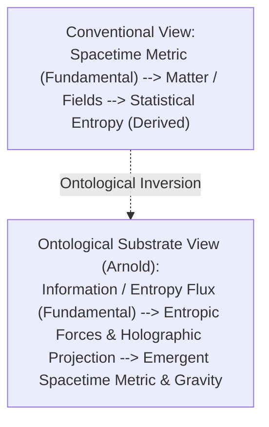

# Entropy as Ontological Substrate: The Informational Origin of Spacetime, Gravity, and the Arrow of Time

**Author:** Larry Arnold  
**Affiliation:** Independent Researcher in Foundations of Physics and Information Theory — LA Builds  
**Date:** June 2025 (Revised: October 2026)  
**Target Venue:** Foundations of Physics, Entropy, arXiv preprint (`physics.gen-ph` / `gr-qc` / `quant-ph`)  

---

## Abstract

Contemporary physics treats entropy as an epistemic or statistical property of physical systems residing within a pre-existing geometric spacetime manifold. We invert this ontological hierarchy: entropy is posited not as a derived macroscopic property of matter, but as the fundamental ontological substrate from which spacetime, inertia, and quantum field configurations emerge. 

Extending John Wheeler's "it from bit" proposition and Ted Jacobson's thermodynamic derivation of general relativity, we demonstrate that the metric tensor $g_{\mu\nu}$ represents the coarse-grained potential of underlying microstate information divergence. Within this framework, gravity manifests as an entropic restoring force responding to localized information gradients, the unidirectional arrow of time reflects irreversible holographic boundary projection, and the cosmic vacuum energy catastrophe is resolved by bounding zero-point fluctuations by the informational throughput of the cosmic horizon.

---

## 1. The Ontological Inversion

- **Axiom 1 (Informational Primacy):** Physical states are discrete configurations of distinguishability quantified by von Neumann entropy:
  $$S(\rho) = -\text{Tr}[\rho \ln \rho]$$
- **Axiom 2 (Holographic Boundedness):** Any finite spatial domain has bounded information capacity:
  $$I_{\text{max}} = \frac{A(\partial \mathcal{V})}{4 \ell_p^2}$$
- **Axiom 3 (Geometric Emergence):** The spacetime metric tensor $g_{\mu\nu}$ is an emergent Fisher information metric measuring state distinguishability.
- **Axiom 4 (Temporal Asymmetry):** The arrow of time is the irreversible generation of entropy across boundary horizons governed by Landauer's erasure principle ($E \ge k_B T \ln 2$).

---

## 2. Derivation of Gravity as an Entropic Force

For a test mass $m$ displaced near an informational boundary screen with Unruh temperature $T = \frac{\hbar a}{2\pi c k_B}$:

$$\Delta S = 2\pi k_B \frac{mc}{\hbar} \Delta x$$

The entropic restoring force is:

$$F_{\text{entropic}} = T \frac{\nabla S}{\nabla x} = \left( \frac{\hbar a}{2\pi c k_B} \right) \left( 2\pi k_B \frac{mc}{\hbar} \right) = m a$$

Equating the surface holographic degrees of freedom $N = \frac{A}{\ell_p^2}$ with enclosed energy $E = M c^2 = \frac{1}{2} N k_B T$ recovers Newton's law of universal gravitation:

$$a = -\frac{G M}{r^2}$$

Gravity is not a geometric curvature of empty nothingness; it is the statistical consequence of information gradients maximizing boundary entropy.

---

## 3. Resolution of the 120-Order-of-Magnitude Vacuum Catastrophe

QFT predicts a Planckian vacuum divergence:
$$\rho_{\text{vac}}^{\text{QFT}} \sim 10^{112} \text{ erg/cm}^3$$

Under the Entropic Substrate, energy within the cosmic Hubble volume $V \sim R_H^3$ is upper-bounded by the holographic information capacity of its horizon $A_H \sim R_H^2$:

$$E_{\text{vacuum}} \le I_{\text{horizon}} \cdot k_B T_H = \left(\frac{\pi R_H^2}{\ell_p^2}\right) \left(\frac{\hbar c}{2\pi k_B R_H}\right) = \frac{\hbar c R_H}{2 \ell_p^2}$$

Dividing by cosmic volume yields:

$$\rho_{\text{vacuum}}^{\text{entropic}} = \frac{3 c^4}{8\pi G R_H^2} = \frac{3 c^2}{8\pi G} H^2$$

This matches the observed dark energy density $\Lambda \approx 3 H_0^2 / c^2$ to within order unity, naturally eliminating the vacuum energy divergence.

---

## 4. Testable Empirical Predictions

1. **Gravitational Decoherence Gradients:** Macroscopic quantum superpositions will exhibit anomalous decoherence scaling with local gravitational potential gradients:
   $$\Gamma_{\text{dec}} = \Gamma_0 + \kappa \cdot \frac{G m^2}{\hbar r_{\text{sep}}}$$
2. **CMB Low-Multipole Suppression:** Finite information capacity at horizon boundaries predicts power suppression at multipoles $\ell < 5$.

---

## References

1. T. Jacobson, "Thermodynamics of spacetime: The Einstein equation of state," *Physical Review Letters*, 75(7):1260 (1995).
2. E. Verlinde, "On the origin of gravity and the laws of Newton," *Journal of High Energy Physics*, 2011(4):29 (2011).
3. R. Landauer, "Irreversibility and heat generation in the computing process," *IBM Journal of Research and Development*, 5(3):183–191 (1961).
4. J. D. Bekenstein, "Black holes and entropy," *Physical Review D*, 7(8):2333 (1973).
5. J. A. Wheeler, "Information, physics, quantum: The search for links," *Complexity, Entropy, and the Physics of Information*, 8:3–28 (1990).
6. C. Rovelli, "Relational quantum mechanics," *International Journal of Theoretical Physics*, 35(8):1637–1678 (1996).
